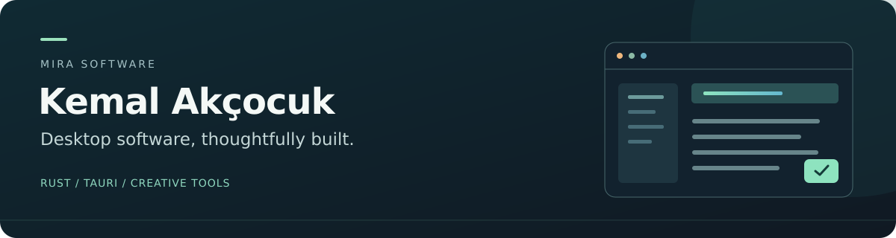

  

  <a href="https://github.com/OlgunBeyaz?tab=repositories"><strong>Explore my projects</strong></a>
  &nbsp; · &nbsp;
  <a href="./docs/MiraNovel.md"><strong>Discover MiraNovel</strong></a>
  &nbsp; · &nbsp;
  <a href="https://github.com/OlgunBeyaz/MiraCommander"><strong>MiraCommander</strong></a>

## Hello, I'm Kemal.

I build desktop applications for writing, file management and everyday work. My focus is on responsive software, clear interfaces and tools that make complex tasks easier to handle.

**Mira Software** brings these projects together: practical utilities alongside applications for creative work.

## In focus · MiraNovel

**A workspace for stories, characters and the worlds they inhabit.**

MiraNovel brings manuscript editing, scene organization, character and location information, a corkboard, an outline and a timeline into a desktop writing environment.

Built with **Rust, Tauri and Svelte**. Currently in active development with initial testers.

[**Read the project introduction →**](./docs/MiraNovel.md)

## Explore my work

| Project | Purpose | Built with |
| :--- | :--- | :--- |
| [**MiraCommander**](https://github.com/OlgunBeyaz/MiraCommander) | A classic dual-pane file manager with keyboard navigation, previews, archive tools and file search. | Rust · Tauri 2 · TypeScript |
| [**mdedit**](https://github.com/OlgunBeyaz/mdedit) | A Markdown editor with live preview, syntax highlighting and a split editing view. | C++17 · Qt 6 |
| [**Mira-Dll**](https://github.com/OlgunBeyaz/dll-export) | A Windows utility for inspecting DLL/PE exports, filtering symbols and exporting CSV reports. | Python |
| [**Homebrew App Store**](https://github.com/OlgunBeyaz/Homebrew-App-Store) | A desktop interface for browsing, installing and removing Homebrew Cask applications on macOS. | JavaScript · Electron |

## How I build

**Native foundations.** Rust and C++ for desktop software and system integration.

**Clear interfaces.** Tauri, Svelte, TypeScript and Qt for focused working environments.

**Useful tools.** Python and JavaScript for utilities and supporting workflows.

## Currently exploring

- Writing tools that keep a manuscript and its story context together.
- **Dilek**, a dictionary component, starting with Turkish offline word lookup.
- Ways to make familiar desktop workflows more comfortable and efficient.

---

  <strong>Have a suggestion or found a problem?</strong> 
  Open an issue in the relevant public project.  
  <a href="https://github.com/OlgunBeyaz?tab=repositories">Browse repositories</a>
  &nbsp; · &nbsp;
  <a href="https://github.com/OlgunBeyaz/MiraCommander/issues">MiraCommander feedback</a>

